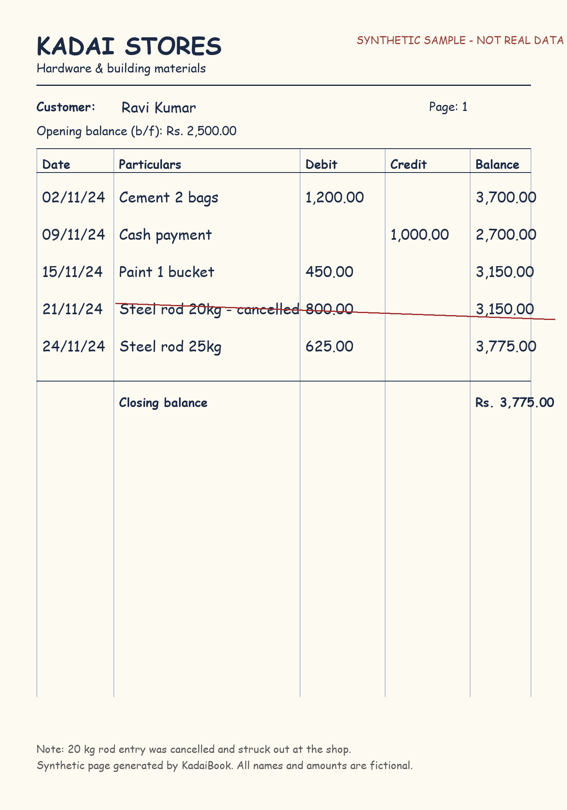
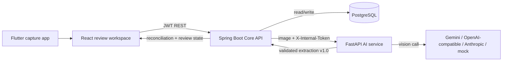

# KadaiBook

**AI notebook digitizer for small shops.** Photograph a handwritten credit
notebook, extract the entries with a vision model, then review, reconcile, and
confirm them before anything becomes part of the ledger.

The AI service reads and flags. It never writes to the ledger, invents missing
values, or calculates balances. Deterministic Java code owns money, matching,
reconciliation, review state, and the audit trail.



## Why this exists

Small shops in India still run on handwritten credit notebooks ("kadai book").
The entries are personal, abbreviated, corrected, and sometimes struck out. A
generic OCR dump is not enough: the shopkeeper needs a reviewable record that
preserves uncertainty instead of silently guessing.

KadaiBook is built around three rules:

1. **AI output is advisory.** Every extracted value is untrusted until a person
   reviews it.
2. **Unreadable means unreadable.** Missing values stay `null`; they are never
   replaced with zero, today's date, or a guessed customer.
3. **Money is exact.** Amounts are integer paise (`BIGINT`) end to end. No
   floating point in storage, transport, or arithmetic.

## Architecture



| Component | Stack | Responsibility |
| --- | --- | --- |
| [`ai-service`](ai-service) | Python 3.11, FastAPI, LangGraph, OpenCV | Preprocess the page, classify the layout, call the vision model, validate against the shared contract, tag issues for review |
| [`core-api`](core-api) | Java 17, Spring Boot 3, PostgreSQL, Flyway | Authentication, shops, pages, customers, deterministic reconciliation, review workflow, audit log, retention, S3/local storage |
| [`review-ui`](review-ui) | React 18, TypeScript, Vite | Side-by-side page image and extracted entries, inline corrections, balance confirmation, customer ledger, audit view |
| [`mobile-app`](mobile-app) | Flutter | Mobile capture client (current scaffold; API wiring still in progress) |
| [`contracts`](contracts) | JSON Schema | Single boundary contract shared by the AI service, Core API, and evaluation labels |
| [`sample-data`](sample-data) | Synthetic page + labels | Demo image, ground-truth extraction, and eval manifest |

### Extraction pipeline

The AI service runs a LangGraph state machine:

1. Deterministic preprocessing (EXIF correction, deskew, content crop, CLAHE
   contrast, size bound) with OpenCV. No model is involved in cleanup.
2. Page layout classification.
3. Structured extraction with a bounded retry budget.
4. JSON parsing, Pydantic validation, and validation against
   `contracts/extraction-schema-v1.0.json`.
5. Deterministic issue tagging for ambiguous dates, missing amounts, crossed-out
   entries, unreadable customers, missing running totals, and similar cases.

The Core API validates the same JSON Schema again before persisting anything,
then computes balances and match status independently.

## Repository layout

```text
ai-service/    FastAPI vision service, LangGraph pipeline, tests, eval harness
core-api/      Spring Boot ledger and review API, Flyway migrations, tests
review-ui/     React + Vite reviewer workspace
mobile-app/    Flutter capture app (scaffold)
contracts/     extraction-schema-v1.0.json and issue-code documentation
sample-data/   Synthetic ledger image, expected output, eval manifest
```

## Quick start

### Prerequisites

- Docker (PostgreSQL)
- Python 3.11+
- JDK 17 and Maven 3.9+
- Node.js 20+
- Flutter 3.9+ (only for the mobile app)

### 1. Start PostgreSQL

```powershell
docker run --name kadaibook-db `
  -e POSTGRES_DB=kadaibook `
  -e POSTGRES_USER=kadai `
  -e POSTGRES_PASSWORD=kadai `
  -p 5433:5432 -d postgres:16
```

The Core API defaults to `jdbc:postgresql://localhost:5433/kadaibook` with user
`kadai` and password `kadai`. Flyway creates the schema on first start.

### 2. Run the AI service

```powershell
cd ai-service
python -m venv .venv
.\.venv\Scripts\Activate.ps1
pip install -r requirements-dev.txt
Copy-Item ..\.env.example .env
# For a fully offline demo, set VISION_PROVIDER=mock in .env.
# For Gemini, set VISION_PROVIDER=google and GOOGLE_API_KEY.
python -m app.main
```

The service listens on `http://localhost:8000`. Check `GET /healthz` for the
active provider, model, prompt version, and schema version.

### 3. Run the Core API

```powershell
cd core-api
$env:SERVER_PORT = "18080"
$env:DEMO_SEED = "true"
mvn spring-boot:run
```

The API listens on `http://localhost:18080`. The Vite dev proxy already targets
port `18080`; if you prefer `8080`, set `VITE_PROXY_TARGET` for the review UI.

- Swagger UI: <http://localhost:18080/swagger-ui.html>
- Health: <http://localhost:18080/actuator/health>

With `DEMO_SEED=true`, the seeder creates a demo shop and customers.

### 4. Run the review UI

```powershell
cd review-ui
npm ci
npm run dev
```

Open <http://localhost:5173>.

Demo login (only when `DEMO_SEED=true`):

- Phone: `+919000000001`
- Password: `kadaibook123`

Change these through `DEMO_PHONE`, `DEMO_PASSWORD`, and `DEMO_DISPLAY_NAME`
before using the app with real data.

### 5. Mobile app (optional)

```powershell
cd mobile-app
flutter pub get
flutter run
```

The Flutter app is currently the default capture scaffold and is not yet wired
to the Core API.

## Configuration

Copy `.env.example` to `.env` for the AI service and use the same names as
environment variables for the Core API. Secrets are never committed.

| Variable | Default | Used by | Purpose |
| --- | --- | --- | --- |
| `VISION_PROVIDER` | `mock` | AI | `mock`, `google`, `openai_compatible`, or `anthropic` |
| `VISION_MODEL` | `mock-v1` | AI | Provider model name |
| `GOOGLE_API_KEY` | empty | AI | Gemini API key |
| `GOOGLE_THINKING_LEVEL` | `low` | AI | Gemini thinking budget level |
| `VISION_BASE_URL` | OpenAI | AI | Base URL for OpenAI-compatible providers |
| `VISION_API_KEY` | empty | AI | Key for OpenAI-compatible providers |
| `ANTHROPIC_API_KEY` | empty | AI | Claude API key |
| `AI_SERVICE_TOKEN` | `dev-internal-token` | AI + Core | Shared secret for service-to-service calls |
| `AI_SERVICE_URL` | `http://localhost:8000` | Core | AI service base URL |
| `DB_URL` | `jdbc:postgresql://localhost:5433/kadaibook` | Core | JDBC URL |
| `DB_USER` / `DB_PASSWORD` | `kadai` / `kadai` | Core | Database credentials |
| `JWT_SECRET` | dev-only placeholder | Core | JWT signing secret; at least 32 characters |
| `SERVER_PORT` | `8080` | Core | HTTP port |
| `CORS_ALLOWED_ORIGINS` | `http://localhost:5173` | Core | Allowed browser origins |
| `STORAGE_BACKEND` | `local` | Core | `local` or `s3` |
| `STORAGE_LOCAL_ROOT` | `./data/pages` | Core | Local page-image root |
| `S3_BUCKET` / `S3_KMS_KEY_ID` | empty | Core | Required when `STORAGE_BACKEND=s3` |
| `IMAGE_RETENTION_DAYS` | `30` | Core | Page-image retention window |
| `DEMO_SEED` | `false` | Core | Create the demo shop and customers |
| `VITE_API_BASE` | empty (same origin) | UI | API base URL for production builds |
| `VITE_PROXY_TARGET` | `http://127.0.0.1:18080` | UI | Dev proxy target |

### AI providers

- `mock` - deterministic fixture provider, no network calls; used for offline
  development and harness tests.
- `google` - Gemini via the Google Generative Language API.
- `openai_compatible` - any OpenAI-compatible chat-completions endpoint,
  including hosted gateways and local Ollama.
- `anthropic` - Claude messages API.

## API surface

All endpoints except registration, login, health, and OpenAPI docs require a
bearer JWT.

| Method | Path | Purpose |
| --- | --- | --- |
| `POST` | `/api/v1/auth/register` | Create an account |
| `POST` | `/api/v1/auth/login` | Obtain a JWT |
| `GET` | `/api/v1/auth/me` | Current user |
| `GET` / `POST` | `/api/v1/shops` | List or create shops |
| `GET` | `/api/v1/shops/{shopId}/pages` | List pages |
| `POST` | `/api/v1/shops/{shopId}/pages` | Upload a page image (deduplicated by SHA-256) |
| `GET` | `/api/v1/shops/{shopId}/pages/{pageId}` | Page detail with extraction and review state |
| `POST` | `/api/v1/shops/{shopId}/pages/{pageId}/extract` | Run extraction |
| `GET` | `/api/v1/shops/{shopId}/pages/{pageId}/image` | Authenticated page image |
| `PUT` | `/api/v1/shops/{shopId}/pages/{pageId}/entries/{entryId}/review` | Review one entry |
| `POST` | `/api/v1/shops/{shopId}/pages/{pageId}/confirm` | Confirm page balances |
| `POST` | `/api/v1/shops/{shopId}/pages/{pageId}/bulk-confirm` | Confirm multiple rows |
| `DELETE` | `/api/v1/shops/{shopId}/pages/{pageId}` | Delete a page |
| `GET` / `POST` | `/api/v1/shops/{shopId}/customers` | List or create customers |
| `GET` | `/api/v1/shops/{shopId}/customers/{customerId}/ledger` | Customer ledger |
| `GET` | `/api/v1/shops/{shopId}/audit` | Audit trail |

## Testing

```powershell
# AI service
cd ai-service
python -m pytest
ruff check .

# Core API
cd core-api
mvn test

# Review UI
cd review-ui
npm run build

# Mobile app
cd mobile-app
flutter test
```

### Extraction evaluation

The eval harness scores predictions against labelled JSON using the same
contract shape. It reports entry accuracy, amount accuracy, customer matching,
balance reconciliation, review rate, and the missed-error rate (wrong values
that reached a reviewer without a warning).

```powershell
cd ai-service
python -m evals.run_eval --manifest ..\sample-data\manifest.json --out-dir evals\out\mock-sample
```

The mock provider result only proves the harness works. It is not model
accuracy and must not be presented as pilot results.

## Security and privacy

- Page images are served only through authenticated endpoints.
- Local storage is intended for encrypted-at-rest hosts; S3 mode requires a KMS
  key.
- Page images are deleted after the retention window while ledger data and audit
  history remain.
- Service-to-service extraction calls require `X-Internal-Token`.
- JWT secret, provider keys, and database credentials are environment-only.
- Uploads are validated for size, pixel count, content type, and decodability.
- Duplicate uploads are detected per shop by SHA-256.

For any real deployment, replace every development default (`JWT_SECRET`,
`AI_SERVICE_TOKEN`, demo credentials), run over TLS, and use a managed secret
store.

## Project status

Implemented: extraction pipeline with four providers, contract validation,
deterministic issue tagging, JWT authentication, shops/pages/customers, review
and confirmation workflow, reconciliation, audit log, retention, local and S3
storage, mock eval harness, and the React review workspace.

In progress: wiring the Flutter capture app to the Core API. There is no
production deployment configuration in this repository yet.
